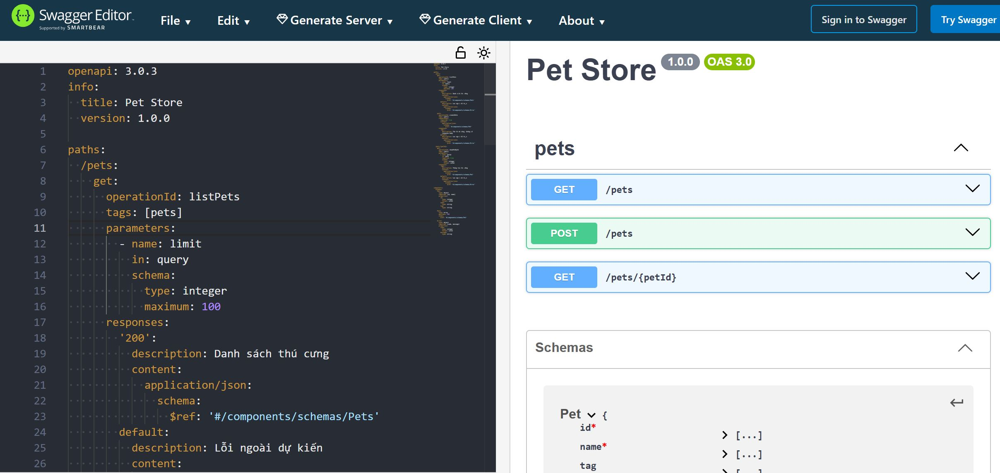
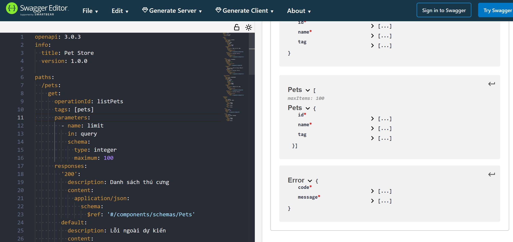
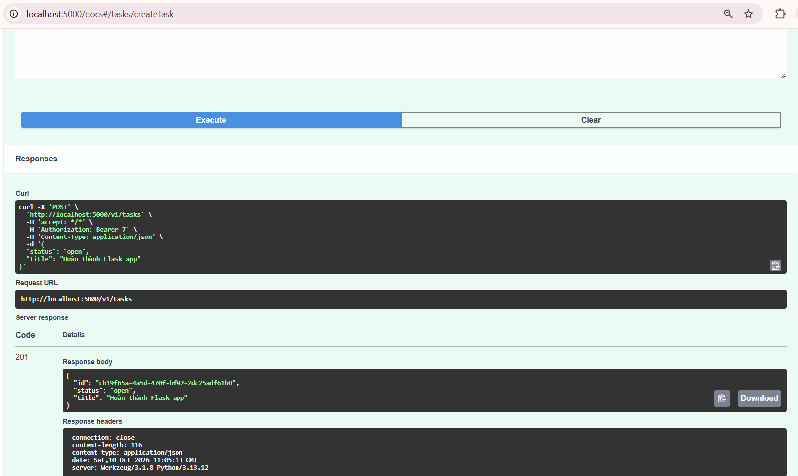
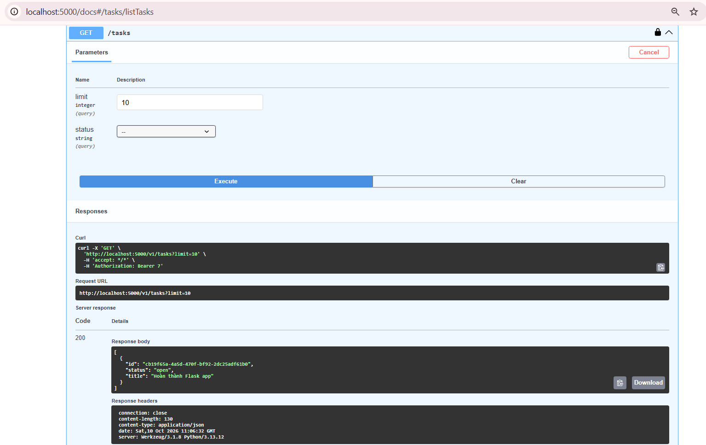
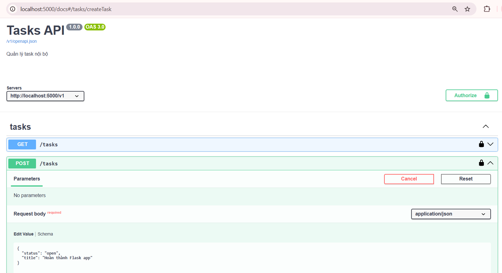

Specification và documentation của Pet Store.

Tạo task mới thành công.

GET danh sách tasks có task vừa tạo.

Tạo 1 task mới bằng POST.

## Mô tả 2 quyết định thiết kế khó nhất

1. Tách CreateTask và UpdateTask vì hai thao tác có yêu cầu khác nhau. Khi tạo task, title là bắt buộc. Khi cập nhật bằng PATCH, người dùng chỉ cần gửi trường muốn sửa, các trường còn lại giữ nguyên. Cách này phải khai báo thêm schema nhưng giúp dữ liệu đầu vào rõ ràng và tránh cập nhật nhầm thông tin.
2. Đọc trực tiếp file openapi.yaml trong Flask, trả nội dung qua /v1/openapi.json để Swagger UI sử dụng. Cách này không cần viết riêng một bản JSON, nên khi sửa đặc tả chỉ cần sửa file YAML rồi khởi động lại app. Tuy nhiên, nhóm vẫn phải kiểm tra code xử lý có đúng với đặc tả hay không.
