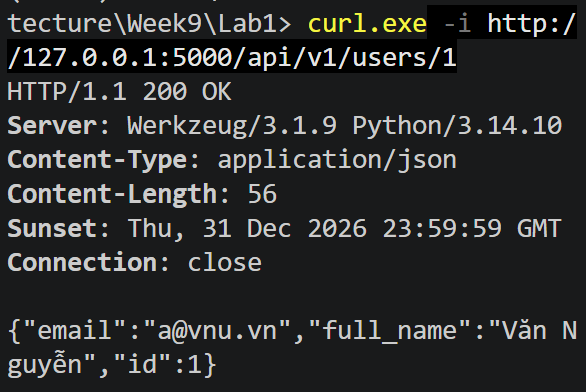
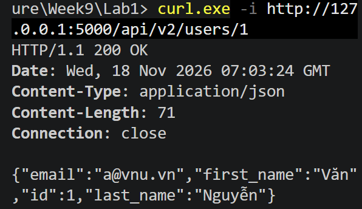
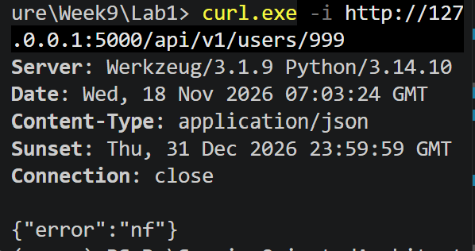
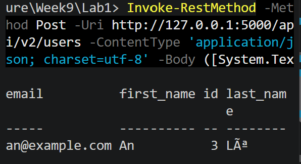
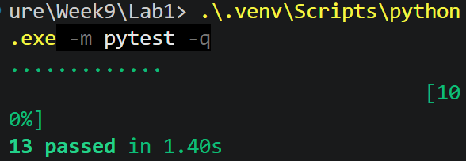



Gọi GET `/api/v1/users/1` thành công với HTTP 200. API v1 trả về `id`, `full_name` và `email`, kèm header `Sunset` thông báo thời điểm dự kiến ngừng hỗ trợ.

Gọi GET `/api/v2/users/1` thành công với HTTP 200. API v2 tách tên thành `first_name` và `last_name`, giữ nguyên `id` và `email`.

Gọi GET `/api/v1/users/999` với ID không tồn tại. API trả về thông báo lỗi `{"error":"nf"}` và vẫn kèm header `Sunset` của v1.

Gửi POST `/api/v2/users` bằng `Invoke-RestMethod` để tạo user mới. Kết quả trả về user có ID 3, tên An và email `an@example.com`; phần họ trong terminal đang hiển thị sai dấu tiếng Việt.

Chạy `python -m pytest -q` trong môi trường ảo. Cả 13 kiểm thử đều thành công, hoàn tất trong 1,40 giây.
