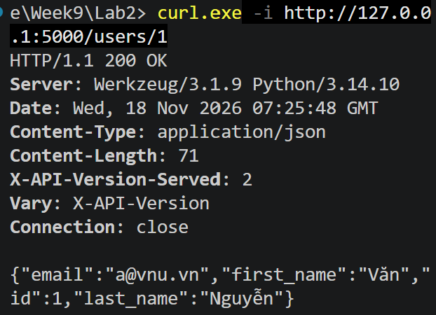
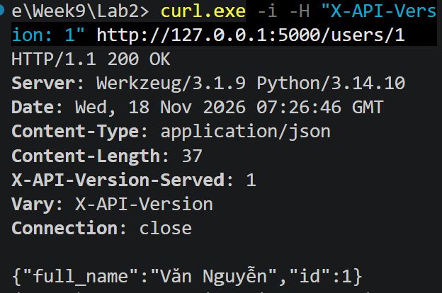
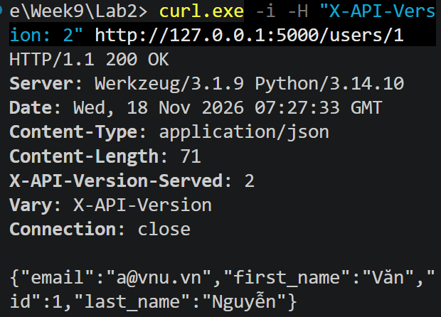
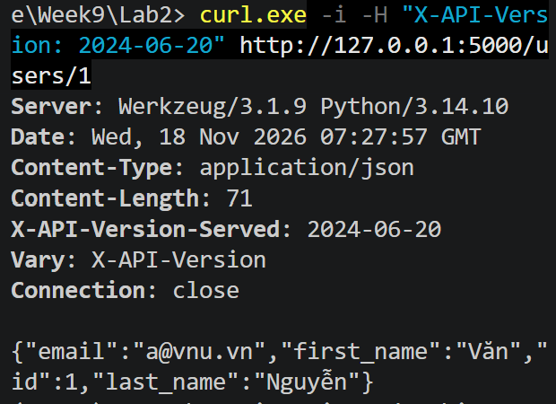
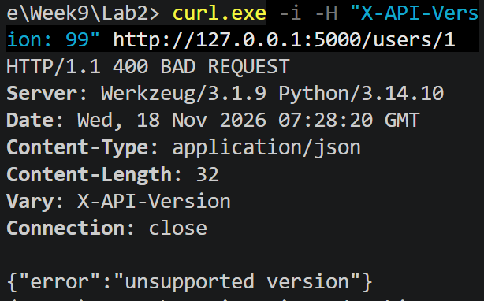
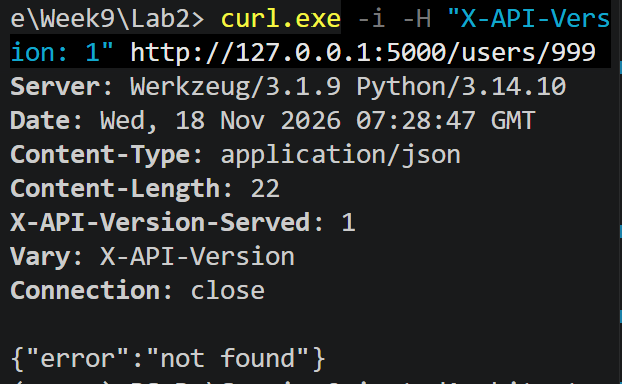
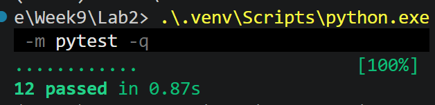



Gọi GET `/users/1` không kèm header `X-API-Version`. API mặc định dùng v2, trả HTTP 200 với `id`, `first_name`, `last_name`, `email` và header `X-API-Version-Served: 2`.

Gọi GET `/users/1` với `X-API-Version: 1`. API trả HTTP 200 với `id`, `full_name` và header `X-API-Version-Served: 1`.

Gọi GET `/users/1` với `X-API-Version: 2`. API trả HTTP 200, tách tên thành `first_name` và `last_name`, kèm `id`, `email` và header `X-API-Version-Served: 2`.

Gọi GET `/users/1` với `X-API-Version: 2024-06-20`. API trả dữ liệu cùng cấu trúc với v2 và header `X-API-Version-Served: 2024-06-20`, xác nhận phiên bản đã xử lý yêu cầu.

Gọi GET `/users/1` với `X-API-Version: 99`. API trả HTTP 400 Bad Request cùng thông báo `{"error":"unsupported version"}`, không tự chuyển sang phiên bản mặc định.

Gọi GET `/users/999` với `X-API-Version: 1`. API trả thông báo `{"error":"not found"}` và vẫn gắn header `X-API-Version-Served: 1` để xác định phiên bản xử lý yêu cầu.

Chạy `python -m pytest -q` trong môi trường ảo. Cả 12 kiểm thử đều thành công, hoàn tất trong 0,87 giây.
