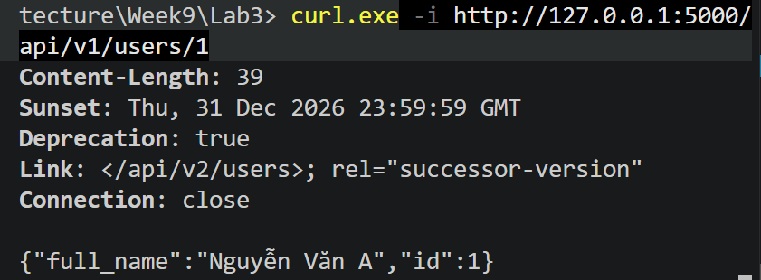
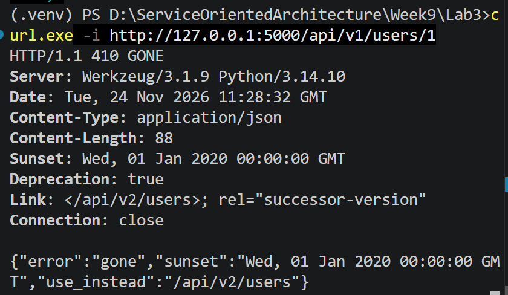
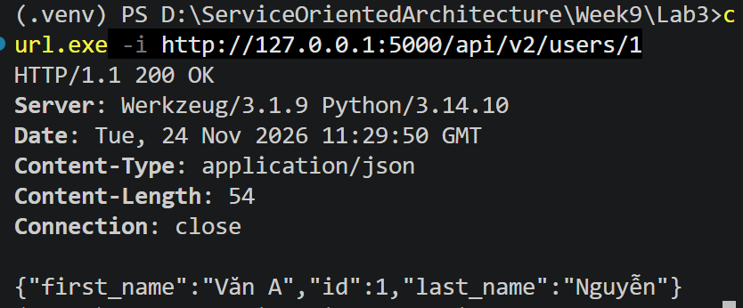
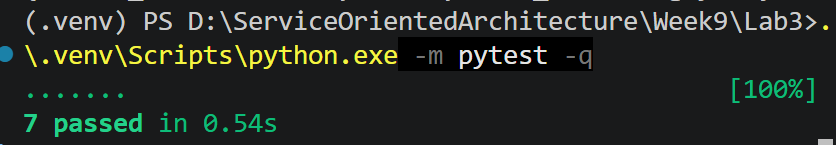



Gọi GET `/api/v1/users/1` trước hạn ngừng hỗ trợ. API trả dữ liệu user với `full_name: Nguyễn Văn A`, kèm các header `Sunset: Thu, 31 Dec 2026 23:59:59 GMT`, `Deprecation: true` và `Link` trỏ tới phiên bản kế tiếp `/api/v2/users`.

Gọi GET `/api/v1/users/1` khi cấu hình ngày Sunset đã qua là `01/01/2020`. API trả HTTP 410 Gone với `error: gone`, thời điểm Sunset và `use_instead: /api/v2/users`; các header Sunset, Deprecation và Link vẫn được giữ.

Gọi GET `/api/v2/users/1` nhận HTTP 200 OK với `id`, `first_name` và `last_name`. Phiên bản v2 vẫn hoạt động khi v1 hết hạn và không có các header Sunset, Deprecation hay Link.

Chạy `python -m pytest -q` trong môi trường ảo. Cả 7 kiểm thử đều thành công, hoàn tất trong 0,54 giây.
