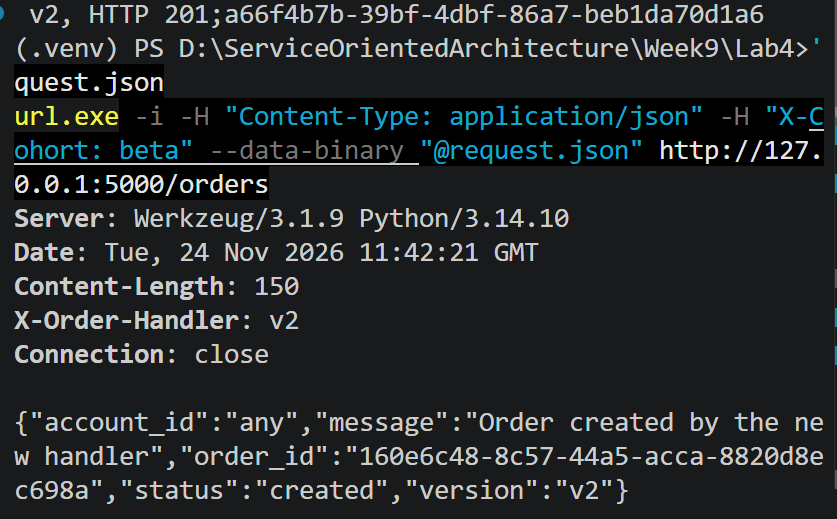
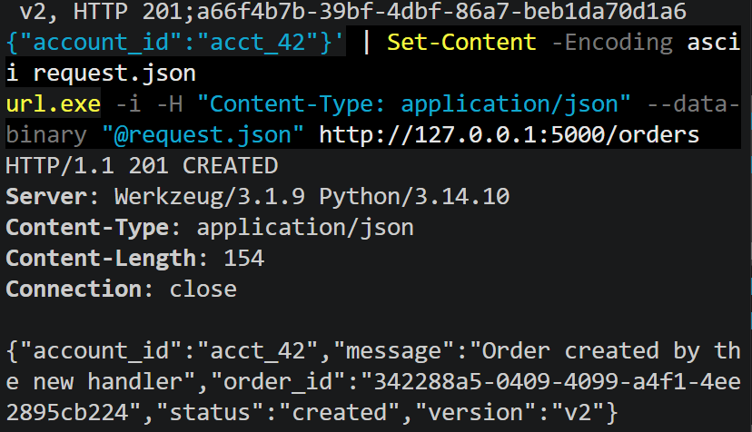
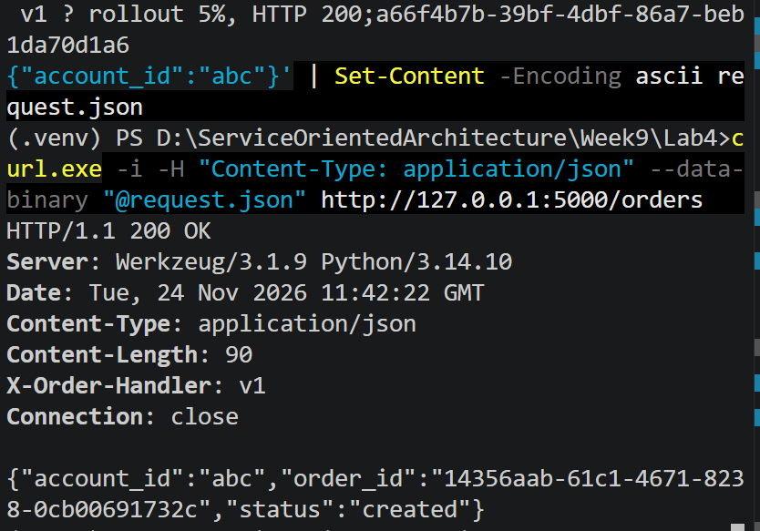
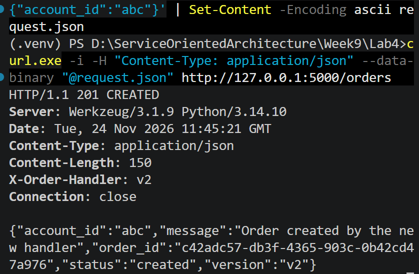



Gửi POST `/orders` với tài khoản `any` và header `X-Cohort: beta`. Gateway ưu tiên chuyển yêu cầu sang v2, thể hiện qua header `X-Order-Handler: v2` và dữ liệu đơn hàng có `version: v2`.

Gửi POST `/orders` với `account_id: acct_42`, không kèm header cohort. Do tài khoản thuộc allow-list, gateway chọn v2 và trả HTTP 201 Created cùng thông tin đơn hàng mới.

Gửi POST `/orders` với tài khoản `abc` khi rollout ở mức 5%. Tài khoản có bucket 70 nên được xử lý bằng v1; response trả HTTP 200 OK và header `X-Order-Handler: v1`.

Gửi lại POST `/orders` với tài khoản `abc` sau khi tăng rollout lên 100%. Gateway chuyển sang v2, trả HTTP 201 Created, header `X-Order-Handler: v2` và dữ liệu có `version: v2`.
